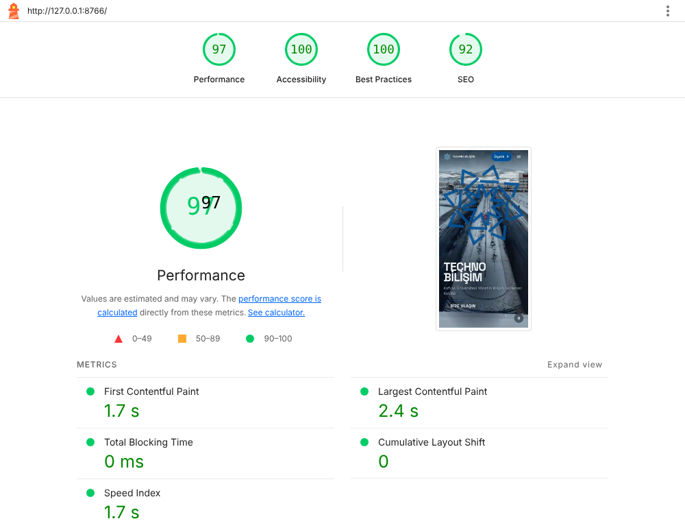

# Techno Bilişim Kulübü — web sitesi

Kafkas Üniversitesi Techno Bilişim Kulübü'nün 3D tanıtım sitesi. Statik site, derleme adımı yok:
`index.html` + `css/site.css` + `js/*.js` (ES modülleri) + `media/` + `fonts/`. GitHub Pages'te olduğu gibi çalışır.

**Yerelde açmak:** klasörde `python3 -m http.server` çalıştırıp `http://localhost:8000` adresine git
(modüller `file://` ile açılmaz).

## Bir metni değiştirmek

`index.html`'de metni bul, değiştir, kaydet, GitHub'a gönder. Bütün metinler HTML'de durur.
(`data/icerik.json` yalnızca arşivdir; sayfa onu okumaz.)

Sayılarla ilgili not: "24 faaliyet · 6 video · 26 fotoğraf · 17 arşiv kaydı" şeridi (`.sayilar`) ve
faaliyet sayacı (`.faaliyet-sayac`) HTML'e elle yazılıdır. Faaliyet ya da fotoğraf eklersen bu sayıları da
güncelle (`data-sayi="…"` özniteliği ve içindeki metin aynı olmalı). Anı tüneli bölümündeki "Kulüp arşivinden 26 kare." ve
"Izgara olarak gör (26)" da öyle.

## Yeni fotoğraf eklemek

1. İki boy üret ve `media/foto/`'ya koy:
   ```
   cwebp -q 70 -resize 640 0 foto.jpg -o media/foto/ad-640.webp
   cwebp -q 72 -resize 1280 0 foto.jpg -o media/foto/ad-1280.webp
   ```
   (ya da squoosh.app'te aynı ayarlar).
2. HTML'e küçük resmi ekle; `width`/`height` 640'lık dosyanın gerçek boyu, `data-w`/`data-h` orijinal fotoğrafın boyu:
   ```html
   <a class="foto" href="media/foto/ad-1280.webp"></a>
   ```
   Bir faaliyet kartında `<div class="zk-fotolar" data-galeri>` içine koy; tıklanınca görüntüleyici o kartın fotoğraflarıyla açılır.
3. Anı tüneline eklemek için `<ol class="tunel-liste">` içine aynı bağlantıyı bir `<li>` olarak ekle.
   (Tünelin iz yüksekliği CSS'te `26 * 22vh` ile hesaplanır; fotoğraf sayısı değişirse `css/site.css`'te
   `.tunel-iz` satırındaki 26'yı da güncelle.)

## Yeni video eklemek

```
ffmpeg -i video.mp4 -vf "scale=540:960:force_original_aspect_ratio=increase,crop=540:960,fps=30" -c:v libx264 -preset slow -crf 28 -maxrate 1.2M -bufsize 2.4M -pix_fmt yuv420p -c:a aac -b:a 96k -movflags +faststart -map_metadata -1 media/video/ad.mp4
ffmpeg -ss 1 -i video.mp4 -frames:v 1 -vf "scale=540:960:force_original_aspect_ratio=increase,crop=540:960" -c:v libwebp -quality 68 media/poster/ad.webp
```
Sesi yoksa ilk komuta `-an` ekle. Sonra `index.html`'de `.akis` içine yeni bir `<article class="kapak">` ekle
(var olanlardan birini kopyala; `id`, `data-i`, `aria-label`, `data-src`, poster ve başlığı değiştir; sesliyse `data-sesli`
ve `.ses` düğmesi kalsın) ve `.akis-noktalar`'a bir numara düğmesi ekle.

## Nasıl çalışır (kısaca)

| Dosya | Görev |
|---|---|
| `js/site.js` | Giriş noktası: üst çubuk, giriş eğrileri, videolar, kapak akışı, zaman çizgisi, sayılar, tünel bağlama |
| `js/motor.js` | Tek `requestAnimationFrame` döngüsü (önce oku, sonra yaz), kademe ölçümü |
| `js/goruntuleyici.js` | Tam ekran fotoğraf görüntüleyici (`<dialog>`) |
| `js/sahne-giris.js`, `js/sahne-tunel.js`, `js/yildiz.js`, `js/tunel.js`, `js/hareket.js` | Paketten **aynen** (Kod Yıldızı, kar, Anı tüneli, bütün eğriler) |
| `js/vendor/three-kulup.min.js` | Three.js 0.186.1'in gereken parçaları; yalnızca 3D sahneler yüklenince iner |

**Kademe (cihaz gücü):** `yuksek` → `orta` → `dusuk` → `yok`. Başlangıçta `deviceMemory`/`hardwareConcurrency`'ye,
sonra giriş sahnesinin ilk 40 karesine göre seçilir; yalnızca aşağı iner. Ekranın yenileme hızına yetişen kareler
"yüksek" sayılır (60 Hz bir ekranda kare aralığı hiçbir zaman 14 ms'nin altına inmediği için).
`yok` (3D'siz yol) şu durumlarda seçilir: WebGL yok, veri tasarrufu açık, azaltılmış hareket açık ya da WebGL yalnızca
**yazılımla** çiziliyor (SwiftShader, llvmpipe; GPU'su kara listede cihazlar). Sonuncusu bilinçli bir karar: donanım
hızlandırması olmadan 3D sahne CPU'da çizilir ve sayfayı kilitler. Bu durumda yıldızın yerinde dönen logo, tünelin yerinde açık ızgara görünür.

**Deneme için** kademeyi zorlamak: tarayıcı konsolunda `localStorage.kademe = "orta"` (ya da `"yuksek"`, `"dusuk"`, `"yok"`)
yazıp sayfayı yenile; geri almak için `localStorage.removeItem("kademe")`.

## Güvenlik

`index.html`'in başındaki `<meta>` CSP: yalnızca kendi sunucudan betik, stil, görsel, video, font. Satır içi betik/stil yok
(`style="…"` yazma; JS'den stil yalnızca `el.style.x = …` ile). Başka bir barındırmaya taşınırsa `_headers` (Netlify/Cloudflare Pages)
ve `.htaccess` (Apache) hazır.

## Ölçümler



Lighthouse 12, mobil (Moto G Power, yavaş 4G, simüle kısıtlama), gzip ve önbellek başlığı veren GitHub Pages benzeri
yerel sunucuda üç çalıştırma, ortanca: **Performans 97 · Erişilebilirlik 100 · En iyi uygulamalar 100 · SEO 92** ·
LCP 2.4 sn (LCP öğesi H1) · CLS 0 · TBT 0 ms.

SEO'daki eksik tek denetim "robots.txt geçerli değil": Lighthouse `robots.txt`'yi sayfanın içinden `fetch` ile okur, CSP'de
`connect-src` olmadığı için bu istek engellenir. Dosya geçerlidir; CSP'ye `connect-src 'self'` eklenince SEO 100 oluyor (denendi).
Spec "connect-src yok" dediği ve güvenlik performanstan önce geldiği için eklenmedi.

Not: Lighthouse'un headless Chrome'u WebGL'i yazılımla çizdiğinden bu ölçüm 3D'siz yolu ölçer (yukarıdaki "Kademe" bölümü).

| Bütçe | Hedef | Ölçülen |
|---|---|---|
| `site.js` + `motor.js` + `goruntuleyici.js` + `hareket.js` (gzip) | ≤ 22 KB | 13.1 KB |
| `css/site.css` (gzip) | ≤ 18 KB | 7.3 KB |
| İlk yükleme (HTML + CSS + fontlar + poster + JS, gzip) | ≤ 300 KB | ≈ 248 KB (mobil poster) · ≈ 299 KB (masaüstü poster) |

## Kabul listesi (Bölüm 11)

Test ortamı: headless Chrome 153, 1440×900, 1280×720, 1024×768, 1024×600, 768×1024, 412×915, 390×844, 375×667, 360×640.
Firefox ve iOS Safari'de denenmedi (bu ortamda yoktu); işaretsiz bırakılanlar gerçek cihazda kontrol edilmeli.

**İçerik**
- [x] `icerik.json`'daki her metin sayfada birebir var (betikle karşılaştırıldı, eksik 0); uydurma metin/sayı yok. "Bilardo turnuvası" ve 3D baskı cümlesi düzeltilmiş.
- [x] 6 video, 24 faaliyet + Ek görseller, 17 arşiv kaydı, 26 fotoğraf, 3 iletişim bloğu. Dış bağlantılar `icerik.json`'daki adreslerle aynı.
- [x] Alt bilgide **"Credit: Codza"** ve Codza işareti.

**3D ve hareket**
- [x] Yıldız açılışta 1.8 sn'de toplanıyor, kaydırınca 45° dönüp dağılıyor, yukarı kaydırınca geri sarılıyor (eğriler hareket.js'te saf fonksiyon).
- [x] Başlık ve yıldız 1440, 1024, 768, 390, 360 (ve aradaki 4 boyut) genişlikte üst üste binmiyor (yıldızın ekrandaki dairesi kamera ayarlarından hesaplanıp başlık kutularıyla karşılaştırıldı).
- [x] Kapak akışı fare, sürükleme, tekerlek, klavye ve noktalarla çalışıyor; yalnızca ortadaki video oynuyor; ses başka videoya geçince kapanıyor.
- [x] Faaliyet kartları katlanarak geliyor, çizgi ışığı aşağı akıyor, filtreler sayacı güncelliyor (Tümü 24 · Zirve 1 · Teknoloji 7 · Kampüs 12 · Kariyer 2 · Sosyal sorumluluk 2).
- [x] Anı tünelinde kamera 26 fotoğrafın içinden geçiyor; sayaç doğru; tıklanan / "Bu kareyi aç" ile seçilen kare görüntüleyicide açılıyor.
- [x] `prefers-reduced-motion` açıkken hiçbir şey kendiliğinden hareket etmiyor (3D yok, video otomatik oynamıyor, akış kapalı, kartlar anında görünür).
- [x] WebGL kapalıyken (`--disable-webgl`) site hatasız; yıldız yerine dönen logo, tünel yerine açık ızgara; Three.js hiç inmiyor.

**Performans ve güvenlik**
- [x] Bölüm 8.3 bütçeleri (yukarıdaki tablo). SEO 92 → açıklaması yukarıda.
- [x] Sayfa açılışında hiçbir `.mp4` ve `-1280.webp` yok; giriş videosu ve Three.js `load` olayından sonra, boşta geliyor.
- [x] Chrome konsolunda sıfır hata, sıfır CSP ihlali. — [ ] Firefox, [ ] Safari iOS
- [x] Sekme arka plana alınınca videolar duraklıyor ve döngü duruyor (`visibilitychange`).
- [ ] iOS Safari'de satır içi oynatma ve `svh` davranışı (kod hazır: `playsinline`, `100svh`) — gerçek iPhone'da denenmeli.
- [ ] Orta seviye Android'de 50+ fps — gerçek cihazda denenmeli.

## Lisanslar

Three.js (MIT, `js/vendor/THREE-LICENSE.txt`), Inter ve Space Grotesk (SIL OFL, `fonts/`).

---


